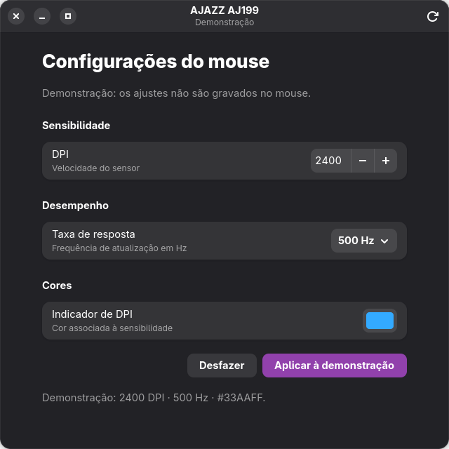

# OpenAjazz

[](https://github.com/taylors42/OpenAjazz/actions/workflows/ci.yml)

Configurador experimental do mouse **AJAZZ AJ199 para Linux/GNOME**, desenvolvido em C#/.NET com GTK4 e libadwaita. Uma tela para ajustar DPI, taxa de resposta e cor do indicador de DPI.

Projeto independente, sem vínculo oficial com a AJAZZ. Esta é uma **prova de conceito (PoC)**, com suporte restrito ao hardware descrito abaixo.



*A captura mostra o modo de demonstração. A execução normal lê e grava o mouse real.*

## Funcionalidades e compatibilidade

- Leitura do perfil atual do aparelho.
- DPI de 100 a 26000, em passos de 50, aplicado igualmente aos eixos X e Y do estágio ativo.
- Taxas configuráveis de 125, 250, 500 e 1000 Hz.
- Cor RGB do indicador de DPI do estágio ativo.
- Backup local antes de escrever e confirmação dos registros por leitura.
- CLI para consulta, configuração e demonstração explícita.

| Hardware | Estado |
| --- | --- |
| AJ199 legado, receptor `25A7:FA7C`, identidade `40:01` | Comunicação, leitura e escrita verificadas; efeito de DPI confirmado pelo usuário |
| Dispositivo por cabo `25A7:FA7B` | Previsto na descoberta; não validado fisicamente |
| Outros modelos ou revisões | Sem suporte confirmado |

Os 1000 Hz atuais foram observados em intervalos de relatórios compatíveis com aproximadamente 1 ms. A troca entre taxas, o efeito visual da cor e a persistência após desligar/religar ainda precisam de confirmação física. Ler os mesmos bytes após uma escrita não comprova, por si só, todos esses efeitos. Consulte [as evidências e limitações](docs/POC.md).

## Requisitos

- Linux x86-64 com sessão gráfica e bibliotecas nativas GTK4, libadwaita e HIDAPI com backend hidraw.
- SDK .NET compatível com [global.json](global.json), para compilar ou usar `dotnet run`.
- Regra udev para permitir acesso ao mouse na sessão local.

Ambiente verificado: Fedora 44, GNOME Shell 50.5/Wayland, GTK 4.22.5, libadwaita 1.9.4, HIDAPI 0.15.0 e SDK .NET 10.0.112. Esses números descrevem o ambiente testado; não estabelecem suporte a versões anteriores.

No Fedora, os pacotes nativos usados são:

```sh
sudo dnf install gtk4 libadwaita hidapi
```

## Compilar e executar

```sh
git clone https://github.com/taylors42/OpenAjazz.git
cd OpenAjazz
dotnet restore Ajazz.sln --locked-mode
dotnet build Ajazz.sln --no-restore
./scripts/run-poc.sh
```

Para instalar a regra de acesso, execute uma vez na raiz do projeto:

```sh
pkexec /usr/bin/bash "$PWD/scripts/install-device-access.sh"
```

Reconecte o receptor se o acesso continuar bloqueado. A regra se limita aos IDs `25A7:FA7B/FA7C`; a interface gráfica roda como usuário normal.

Mantenha o mouse ligado e acordado. Altere os controles e clique em **Aplicar**. **Desfazer** apenas restaura os controles à última leitura, sem escrever no aparelho. O botão de atualizar recarrega o perfil. Se o perfil tiver mudado fora da aplicação, recarregue antes de aplicar novamente.

A cor se refere ao indicador do estágio de DPI, não a uma zona decorativa RGB independente. Macros, remapeamento de botões e múltiplos perfis de hardware estão fora do escopo atual.

## CLI e testes

```sh
dotnet run --project src/Ajazz.Cli -- devices --json
dotnet run --project src/Ajazz.Cli -- info
dotnet run --project src/Ajazz.Cli -- read
# Este comando altera o mouse real:
dotnet run --project src/Ajazz.Cli -- apply 1600 1000 '#00FF00'

dotnet test Ajazz.sln --no-restore
dotnet run --project src/Ajazz.Gnome -- --smoke-test
```

Os testes unitários usam transporte simulado e fixtures revisadas. O smoke test gráfico requer uma sessão gráfica e usa demonstração, sem gravação no mouse. A CI executa restore, build e testes sem hardware.

Backups ficam em `$XDG_STATE_HOME/ajazz/backups` ou `~/.local/state/ajazz/backups`. Contêm a configuração anterior à escrita e não são enviados ao GitHub pela aplicação.

## Documentação e contribuição

- [Execução, publicação local e limites da PoC](docs/POC.md)
- [Protocolo e engenharia reversa](docs/ENGENHARIA_REVERSA.md)
- [Arquitetura e próximos passos](docs/PLANO_LINUX.md)
- [Plano de publicação](docs/PLANO_PUBLICACAO_GITHUB.md)
- [Como contribuir](CONTRIBUTING.md)
- [Dependências e referências](THIRD_PARTY_NOTICES.md)

Licença [MIT](LICENSE). Instaladores Windows, arquivos proprietários extraídos, cópias de ferramentas de pesquisa e diagnósticos pessoais não fazem parte deste repositório.
